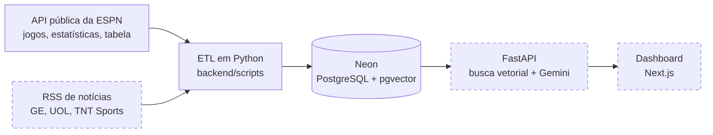

# Sports Analytics AI ⚽

Plataforma de análise preditiva para a **Série A do Campeonato Brasileiro**. Ela cruza estatísticas das partidas (escanteios, cartões, chutes, confrontos diretos) com o contexto das notícias (desfalques, lesões, troca de técnico, clima de bastidores) e gera um relatório com IA para cada jogo.

O projeto roda **100% em planos gratuitos** e também serve de portfólio de engenharia de dados, RAG (Retrieval-Augmented Generation) e integração com LLMs.

> **Status:** Fase 1 concluída. O cliente da ESPN, o banco no Neon com pgvector e os 20 times da Série A já estão prontos. Próximo passo: a ingestão de partidas e notícias. Veja o [roadmap](#roadmap).

---

## O que o relatório vai cobrir

Para cada partida, a IA cruza números e notícias para os quatro principais mercados:

| Mercado | O que pesa na análise |
|---|---|
| **Resultado final (1X2)** | Aproveitamento em casa e fora, confronto direto, troca de técnico, desgaste de viagens e copas |
| **Escanteios** | Média de cantos a favor e contra, chutes bloqueados, jogo pelos lados |
| **Cartões** | Faltas cometidas, rigor do árbitro, clássicos, jogadores pendurados |
| **Gols / Ambas marcam** | Finalizações no alvo, gols nos últimos 5 jogos, desfalques na defesa ou no ataque |

---

## Arquitetura



<sub>Caixas tracejadas = ainda não implementado.</sub>

**Regra de ouro:** o frontend nunca chama as APIs de futebol diretamente. O ETL roda algumas vezes por rodada (antes e depois dos jogos), grava tudo no banco, e a API só lê do banco.

### Stack (custo zero)

| Camada | Tecnologia | Hospedagem |
|---|---|---|
| Backend e ETL | Python 3.11+, FastAPI, httpx, BeautifulSoup4, feedparser | Render (free) |
| Banco relacional + vetorial | PostgreSQL 16 + pgvector | Neon (free) |
| Embeddings | `sentence-transformers` (`intfloat/multilingual-e5-small`, 384 dimensões, roda local) | — |
| LLM | Google Gemini, com saída em JSON estruturado | Google AI Studio (free) |
| Frontend | Next.js (App Router), Tailwind CSS, Recharts | Vercel (Hobby) |

---

## Fontes de dados

### ESPN: temporada atual
API pública, sem chave e sem cota fixa. O plano gratuito da API-Football não libera a temporada 2026, então a ESPN virou a fonte principal. Ela é **não oficial** e pode mudar sem aviso, por isso todo o acesso fica isolado em [`backend/app/services/espn.py`](backend/app/services/espn.py).

| A ESPN fornece | A ESPN **não** fornece (vem das notícias, via RAG) |
|---|---|
| Estatísticas da partida (28 campos: escanteios, cartões, faltas, chutes, posse...) | Árbitro escalado |
| Confronto direto: últimos 5 jogos, várias temporadas | Lesões e suspensões |
| Forma recente: últimos 5 jogos de cada time | Jogadores pendurados |
| Escalações e formação (após a divulgação) | Clima e troca de técnico |
| Odds pré-jogo, classificação e escudos | |

### API-Football: histórico
Usada só para o histórico da temporada 2024 (backtest). O plano gratuito tem 100 requisições por dia.

### Notícias: GE, UOL e TNT Sports *(Fase 2)*
Os feeds RSS são lidos e o texto das matérias é dividido em trechos (chunks). Cada trecho vira um embedding e é gravado no Postgres, onde a busca semântica acontece por SQL com pgvector.

---

## Estrutura do repositório

```
sports-analytics-ai/
├── backend/
│   ├── app/
│   │   ├── api/                  # rotas FastAPI (Fase 3)
│   │   ├── core/
│   │   │   ├── config.py         # configurações lidas do .env (pydantic-settings)
│   │   │   └── db.py             # conexão com o Neon (SQLAlchemy 2.0 + psycopg)
│   │   ├── models/               # schemas Pydantic e modelos (Fase 3)
│   │   └── services/
│   │       ├── espn.py           # cliente da ESPN: temporada atual
│   │       └── api_football.py   # cliente da API-Football: histórico
│   ├── scripts/
│   │   ├── init_db.py                # cria o esquema do banco
│   │   ├── load_teams.py             # carrega os 20 times (upsert)
│   │   ├── explore_espn_summary.py   # mostra o que a ESPN oferece em cada jogo
│   │   ├── test_connection.py        # testa a chave da API-Football
│   │   └── test_espn.py              # primeiro teste exploratório da ESPN
│   ├── sql/
│   │   └── 001_init.sql          # DDL: fonte da verdade do esquema
│   ├── .env.example
│   └── requirements.txt
├── frontend/                     # dashboard Next.js (Fase 4)
└── CLAUDE.md                     # contexto do projeto para o assistente de IA
```

---

## Como rodar localmente

### Pré-requisitos
- Python 3.11 ou mais recente
- Uma conta gratuita no [Neon](https://neon.tech) (o banco Postgres)
- *(opcional)* Uma chave da [API-Football](https://dashboard.api-football.com), só se for usar o histórico

### 1. Instalar

```bash
git clone https://github.com/Leocm123/sports-analytics-ai.git
cd sports-analytics-ai/backend

python3 -m venv .venv
source .venv/bin/activate
pip install -r requirements.txt

cp .env.example .env    # depois preencha as variáveis (veja a tabela abaixo)
```

### 2. Configurar o `.env`

| Variável | Obrigatória? | Para quê |
|---|---|---|
| `DATABASE_URL` | Sim, para usar o banco | Connection string do Neon (*Dashboard → Connect*). Pode colar como o Neon entrega (`postgresql://...`): o `config.py` ajusta o driver sozinho. |
| `APISPORTS_KEY` | Não | Só para o histórico da API-Football e o `test_connection`. |
| `ESPN_BASE_URL`, `ESPN_LEAGUE` | Não | Já têm valor padrão. Só mude se for trocar de liga. |
| `GEMINI_API_KEY`, `GEMINI_MODEL` | Não (Fase 3) | Motor de IA dos relatórios. |

O `.env` está no `.gitignore` e **nunca** deve ser commitado.

### 3. Rodar

Rode todos os comandos a partir de `backend/`, com o venv ativo:

```bash
# Explora a API da ESPN (não precisa de chave nem de banco)
python -m scripts.explore_espn_summary

# Cria as tabelas e a extensão pgvector no Neon
python -m scripts.init_db

# Carrega os 20 times da Série A (pode rodar quantas vezes quiser)
python -m scripts.load_teams
```

Saída esperada do último comando:

```
ESPN devolveu 20 times.
SELECT COUNT(*) FROM times = 20
```

---

## Banco de dados

O esquema fica em [`backend/sql/001_init.sql`](backend/sql/001_init.sql):

| Tabela | Conteúdo |
|---|---|
| `times` | Os clubes da Série A (ID da ESPN, nome, sigla, escudo) |
| `partidas` | Jogos com placar, estatísticas (JSONB) e o cache da análise da IA (JSONB) |
| `noticias` | Trechos de matérias com embedding `vector(384)` e índice HNSW para busca por similaridade |

Decisões importantes:
- **IDs da ESPN** em `times` e `partidas` (não os da API-Football).
- **Tudo idempotente:** o DDL usa `IF NOT EXISTS`, e as cargas usam `INSERT ... ON CONFLICT DO UPDATE`. Rodar duas vezes não duplica nada.
- **Mudanças de esquema** vão em arquivos novos (`002_...sql`, `003_...sql`) com `ALTER TABLE`. O `001_init.sql` não é editado depois de aplicado.

---

## Roadmap

- [x] **Fase 1: Fundação.** Estrutura do repositório, cliente da ESPN, banco Neon com pgvector, DDL e carga dos 20 times.
- [ ] **Fase 2: Ingestão.** Estatísticas das últimas rodadas e scraper de notícias (RSS) com geração de embeddings.
- [ ] **Fase 3: Motor RAG e API.** Busca semântica das notícias dos dois times, relatório do Gemini em JSON validado com Pydantic e endpoints FastAPI.
- [ ] **Fase 4: Frontend e deploy.** Dashboard em Next.js, backend no Render e frontend na Vercel.

---

## Convenções

- **Commits:** `<prefixo>: <descrição em inglês>`, com os prefixos `add`, `remove`, `fix`, `refactor`, `test` e `update`.
  Exemplo: `add: EspnClient service and explore_espn_summary script`
- **Segredos:** nada de chave no código. Tudo vem do `.env` via `pydantic-settings` ([`config.py`](backend/app/core/config.py)).
- **Código didático:** docstrings e comentários explicam o *porquê*, não só o *quê*. Use type hints e funções pequenas.

---

## Autores

- [Leocm123](https://github.com/Leocm123)
- [JoaoPedro-Campos](https://github.com/JoaoPedro-Campos)

---

## Aviso

Projeto educacional e de portfólio. As análises geradas **não são recomendação de aposta**. Apostas envolvem risco financeiro e são proibidas para menores de 18 anos. Jogue com responsabilidade.

Os dados da ESPN vêm de uma API pública e não oficial, usada aqui só para fins de estudo.
